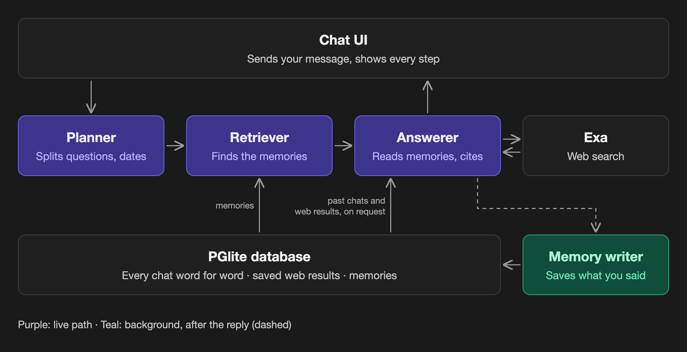

# Design

This is a chat agent with web search that remembers every past conversation. 

The design rests on one idea: **the agent works from memories, and reads the original conversation only when it needs to.** A memory is a short, dated note of what *you* said: a fact about you, a decision, or a question you asked. Every memory points back to the exact conversation it came from. For most questions the memories are enough. When the agent needs what was actually said (its own answer, your exact words, the pages it cited back then), it reads that conversation with a tool. When it talks about the present, it searches the web again.

Each message passes through the purple boxes in order, within a single request. The Memory writer works in the background, after it has replied to the user.

Every language job runs on Anthropic's Claude models, and `.env.example` lists only those. Two models share the work:
- **Claude Sonnet 5.5 writes the answers** Answering is the hardest job, and it reads memories which the agent has learnt about you over time (past sessions).
- **Claude Haiku 5.5**, Anthropic's small, fast and cheap model, it is used in two ways
1) Planner - splits each message into separate questions and decides which ones need past chats or the web. It pulls out time phrases like "last Tuesday", which code turns into exact dates, and it marks broad questions ("what do you know about me?") that should get every memory. Thinking is turned off, so planning stays quick.
2) Memory Writer - after the reply has gone out, writes down what you said in that message: facts about you, decisions you made, and what you asked, each dated and checked against your own words. It thinks a little first, and since it runs in the background, no one waits for it.

Search vectors come from EmbeddingGemma, Google's open embedding model, running inside the Node process. It downloads once on first run.

Each model can be swapped for another Claude model in `.env`, and a backup Claude model can be set behind answering, planning and memory writing. If a model fails or is too busy to reply, that call is retried on the backup.

## Components

### Chat UI
[`public/`](public/) · [`src/server.ts`](src/server.ts)

**Input:** whatever the user types, plus the browser's timezone.

**How it works:** a plain web page served by a small Node server. When you send a message, the server first saves it to the **Database**, so it's kept even if a later step fails. Then it runs the message through the pipeline and streams each step back as it happens.

**Output:** the message and timezone go to the **Planner**. On screen you see every step and the answer as the **Answerer** streams it.

### Planner
[`src/planner.ts`](src/planner.ts) · [`src/timeResolver.ts`](src/timeResolver.ts)

**Input:** the message and timezone from the **Chat UI**, plus the last few turns of the current chat.

**How it works:** a small, fast model reads the message and splits it into separate questions. "Did the CRM tools change pricing, and what did I ask about Postgres last Tuesday?" is two questions. For each question the model:
- decides whether it needs past chats;
- writes a search query with keywords;
- pulls out the time phrase ("last Tuesday");
- notes whose words are being asked about ("what did *I* ask" or "what did *you* tell me").

It also decides whether a question is broad: about you yourself ("what do you know about me?"), a pick based on your tastes ("what should I order tonight?"), or a subject that could mean more than one thing ("what's on the shortlist?" when there are two). A broad question gets every memory, with no search and no filter, because no single topic would cover it. And it guesses whether the web will be needed. Greetings, thanks and small talk need neither past chats nor the web, so a simple "hi" goes straight to the answer. A question that depends on the user's own tastes or situation ("what should I order for me?") does count as needing past chats, even when it doesn't mention one: the user may have said what they like before.

The model never works out dates itself. Code turns the time phrase into an exact window on the user's own calendar: "last Tuesday" becomes Tue 17 Nov, from midnight to midnight in their timezone. "Around Friday" is softer: days near Friday rank higher, but other days still count. If the model call fails, the whole message becomes one question, so the turn still goes ahead.

**Output:** the questions, each with a search query and a date window, go to the **Retriever**. The web guess goes to the **Answerer** as a hint.

### Retriever
[`src/retriever.ts`](src/retriever.ts)

**Input:** the **Planner**'s questions that need past chats. A broad question skips all the steps below: it gets every memory you have, from every earlier chat.

**How it works:** no chat model is involved here. It runs database queries, plus one call that turns the query into a vector. That keeps it fast, testable and consistent: ask the same thing twice and you get the same memories.

1. **Filter by date.** The date window is a hard filter. If you said "last Tuesday", only Tuesday is searched, so a better-matching Wednesday chat can't slip in.
2. **Search.** Inside the window, it searches both the original turns and the memories, by keyword and by meaning, then merges the two rankings. Searching the turns too means a question about what the agent said can still find the right chat, although memories hold only your words.
3. **Apply a relevance bar.** A result must be close enough in meaning, or contain most of the keywords. Without that bar, the least-bad unrelated chat would always come back.
4. **Collect the memories.** It takes the memories of the matching turns, plus the other memories from the same chats, since a decision often comes a message later. Searching the chats is only a way to find the right turns: what goes on is always their memories, and a matching turn with no memory hands over nothing. There is no cap: every chat above the bar counts, so a later correction ("swap Close for Salesforce") is never crowded out. Memories are small, and the Answerer can read them all.

Two cases are handled specially:
- **Nothing on that date.** It says so, and offers the memories of the closest chat from another day, clearly marked as not the conversation you asked about.
- **Only a date.** A question like "What did I ask on 3 Nov?" collects the memories of every chat from that day.

**Output:** for each question, whether it found something, found nothing on that date, or found no match at all, and the memories that go with it. All of this goes to the **Answerer**.

### Answerer
[`src/answerer.ts`](src/answerer.ts) · [`src/promptBuilder.ts`](src/promptBuilder.ts) · [`src/quoteVerifier.ts`](src/quoteVerifier.ts)

**Input:** the **Retriever**'s memories and notes, and the whole current chat. Past chats are not in its prompt.

**How it works:** the main model reads:
- the chat you're in, in full;
- the memories for this message, dated and in date order, with an instruction that a newer memory replaces an older one on the same subject: the team grew, the plan changed, a decision was reversed;
- a short note per question saying what was searched and what was found.

When memories aren't enough, it reads the past itself, with two tools besides web search:
- **Read past chats** returns the full conversations behind chosen memories: the agent's own answers and your exact words. It reads several at once if needed.
- **Read past web results** returns what the agent found back then: its answer, and the passages it cited, word for word, with the page, when it was read and the search that found it.

The tools take only the memories the model was given, and open only the conversations those memories came from. Then the model searches the web through **Exa** where it needs today's facts. It can run several tool calls at once, and as many rounds as it needs; a high backstop only stops a model that keeps re-searching.

For "has anything changed?", it lines up three things for each item:
- what the page said back then (the saved result);
- what the agent told you back then;
- what the page says today.

That lets it give an honest verdict for each item: changed, unchanged, "my earlier answer was wrong", or "couldn't verify". It also keeps suggestions apart from decisions: memories hold only what you said and decided, so "I suggested dropping Freshsales" can never turn into "we decided to drop it".

As the answer streams out, code adds two safety nets:
- **Quotes are checked.** A quote of a past message only shows as a quote if those exact words really are in a message the agent has read. Otherwise it becomes plain text.
- **Sources are listed by code.** The code, not the model, writes the numbered source list, so links are never made up.

A busy model can hold a request for minutes before giving up. So when a backup model is set, a call whose model fails, or hasn't started replying in time, goes to the backup, and the Chat UI shows a step saying so.

**Output:**
- The answer streams to the **Chat UI**.
- The reply and a copy of each page passage it cited are saved to the **PGlite database** and indexed right away, so your next message can already find them.
- The finished turn is queued for the **Memory writer**.

### Exa (web search)
[`src/webSearch.ts`](src/webSearch.ts)

**Input:** a search query from the **Answerer**.

**How it works:** Exa returns each page's text and the passages most relevant to the query, not just links. Any page older than a day is fetched fresh, because "has it changed since Monday?" can't be answered from last month's copy.

**Output:** results with page text, back to the **Answerer**.

### Memory writer
[`src/memoryWriter.ts`](src/memoryWriter.ts)

**Input:** a finished turn from the **Answerer**, via a background queue, so you already have your reply. Along with it come the past turns that were looked up to answer it.

**How it works:** a small model writes down what *you* said, never what the agent said. There are three kinds of memory:
- **facts and needs you state**, such as "The user's favourite food is pasta." or "The user wants a CRM for their 20-person sales team.", including facts you mention in passing while asking something else;
- **decisions you made**, with the full result and the date: "On Wed 18 Nov 2026 the user replaced Close with Salesforce Starter in their CRM shortlist, which became HubSpot, Pipedrive, Salesforce Starter, Zoho CRM and Freshsales.";
- **what you asked**, with the date: "On Tue 3 Nov 2026 the user asked what Notion's Plus plan costs per member." This is what lets the agent find, and then open, the right chat for "What did I ask on 3 November?".

Every memory must quote your own words in that message, and code checks the quote. So nothing comes from the agent's reply, from earlier messages or from other chats; those only help it understand what your words refer to. The agent's suggestions, such as a list of five tools, are saved only once you accept them, and then as the final list you agreed to after any back-and-forth. Small talk isn't stored. The prompt is adapted from mem0's.

Jobs run one at a time, with retries. A job missed because of a crash or an outage is picked up again when the server restarts.

**Output:** memories, saved to the **PGlite database**. Each one points back to the turn it came from. The **Retriever** finds them, and they are what the **Answerer** reads.

### PGlite database
[`src/db.ts`](src/db.ts) · [`src/exchangeStore.ts`](src/exchangeStore.ts)

**Input:**
- each turn, from the **Answerer**: your message, the reply, and copies of the page passages it cited;
- memories, from the **Memory writer**.

**How it works:** it's real Postgres running inside the Node process, so there's no separate database to install or run. It handles both keyword search and meaning (vector) search, and it holds three kinds of data:
- **Turns:** every message and reply, word for word, with the time each was sent. This is the evidence.
- **Saved web results:** the passage of each cited page as it read at the time. This is the baseline for "has it changed?".
- **Memories:** short notes of what you said, each pointing back to its turn.

If the embedding model changes, everything stored is re-embedded once at startup, since vectors from two models can't be compared.

**Output:** memories and search results for the **Retriever**, and past chats and saved web results for the **Answerer**'s tools.

## Why it's built this way

- **Memories first, transcripts on request.** Putting whole past chats into every prompt is slow and expensive, and a long chat can crowd out the one that matters. Memories are small, so the agent sees everything relevant at once; it opens a conversation only when it needs exact words or what it said back then.
- **A memory is your words, never the agent's.** If memories held the agent's suggestions, a proposal could resurface as a decision. Keeping them to what you said, checked against your own words, means the agent never confuses what it suggested with what you decided.
- **A date is a filter, not a preference.** "Last Tuesday" has exactly one right answer. A soft hint would let a better-matching Wednesday chat win, and runs would disagree.
- **Code finds; models talk.** Retrieval is plain code, so it's fast, repeatable and testable. The models plan and write. They never decide what was said.
